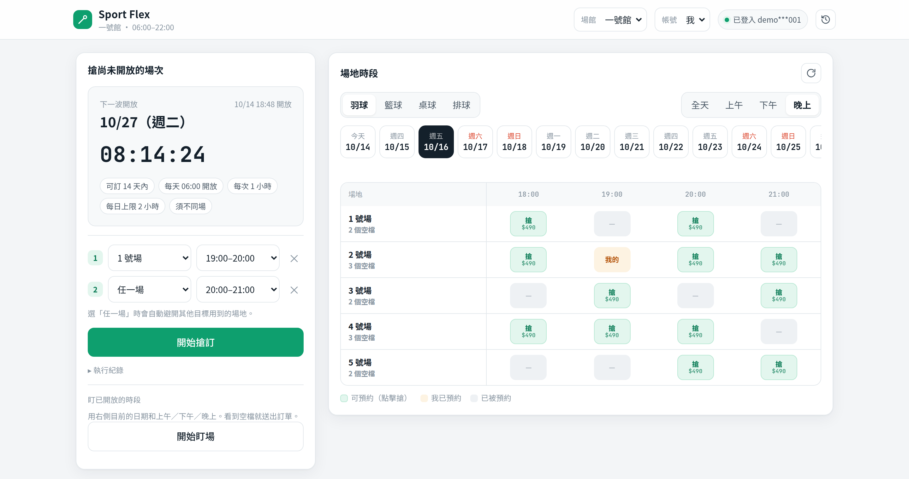
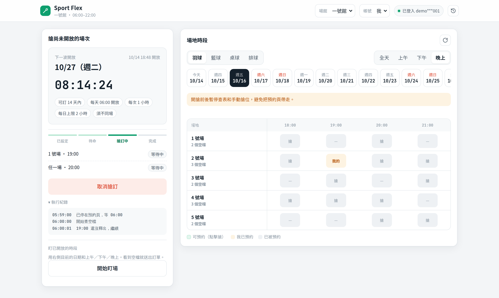
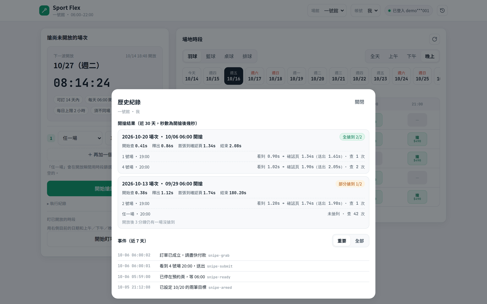

# Sport Flex

[中文](README.md) · [English](README.en.md)

> **Disclaimer.** This tool accepts no responsibility of any kind. It is provided as-is, with no warranty. You use it at your own risk. See [Disclaimer](#disclaimer).

The good slots are often gone the second they open. Sport Flex puts the timetable, the wait until release, and sending the order the moment a slot is free on one screen. It places the order. You still pay it yourself.

## See what is free, and line up the next release



Pick the sport, the date, and morning, afternoon, or evening. A green cell is still free; click it to place the order. The column on the left queues slots that are not open yet: name a court, or choose “any court” and it takes the first one that is free at release.

## The moment it opens



When the countdown ends, it starts checking. Around the release it pauses manual timetable lookups so they do not navigate away from the booking page. Each target stays on “waiting”. When one is booked, you get a reminder to pay.

## How many seconds each attempt took



Every wave keeps the timing: seconds until a free slot was seen, seconds until the confirmation page, and whether the wave was filled. If it missed, watch slots that are already open and book one when somebody cancels.

## Get started

```bash
python3 -m venv .venv
.venv/bin/pip install -r requirements.txt
.venv/bin/playwright install chrome
.venv/bin/python -m sportflex ui
```

Put the account in `.env` at the project root. Do not put it in the config files:

```bash
SPORT_FLEX_DEFAULT_ACCOUNT=
SPORT_FLEX_DEFAULT_PASSWORD=
```

After the browser opens, log in once. That account’s session then stays in its own browser profile.

## The screen does not show the venue’s official name

The menu, confirmation dialogs, Telegram, and command output use only the short name you choose. The official name stays in `name` inside `venues/*.yaml` and is not printed.

```yaml
id: main
label: Court 1        # the name shown on screen
name: official name stays here
provider: changjia
categories: [羽球]
```

Change the short name whenever you like, for example “Court 1” or “Weekday hall”. With several venues, the short names are enough to tell them apart.

## Also

- Weekly slots: for example every Tuesday and Thursday at 20:00, any court. After you save it once, the 14th day is armed automatically before each day’s 06:00 release. Telegram: `/weekly 二四 20:00`. The matching days already open within the 14 days are listed as candidates. Pick the ones to watch, and a slot is booked when someone cancels. On Telegram, `補` picks them all (`/weekly 二四 20:00 補`), or name the days: `/weekly 二四 20:00 補 10/20 10/22`.
- A paid booking gets a morning reminder the day before the no-refund cutoff. The cutoff is read from the venue’s cancellation rule, for example “no refund within 2 days of the booking”. You still cancel it yourself at the counter.
- Watch slots that are already open but full, and place the order when one frees up.
- One platform can have several accounts, each with its own browser, grabbing at the same time.
- With Telegram configured, captchas and successful bookings are sent there. Add `SPORT_FLEX_TELEGRAM_BOT_TOKEN` and `SPORT_FLEX_TELEGRAM_CHAT_ID` to `.env`.
- Backup channels: `SPORT_FLEX_DISCORD_WEBHOOK_URL` (a Discord webhook) and `SPORT_FLEX_NTFY_URL` (an ntfy topic URL such as `https://ntfy.sh/your-topic`; add `SPORT_FLEX_NTFY_TOKEN` for a private topic). When set, grab, payment, and logout notices are sent there together with Telegram, so one blocked channel does not hide the alert. Captcha photos stay on Telegram, because that chat can take a reply. ntfy uses priority 4 unless `SPORT_FLEX_NTFY_PRIORITY` is 1–5.
- `python -m sportflex --help` lists commands to look up courts, slots, and place a booking.
- Docker: `docker compose -f infra/docker-compose.yml up -d --build`, then open `http://127.0.0.1:8765/`.

## Disclaimer

**This tool accepts no responsibility and no liability of any kind.**

Sport Flex is provided “as is” and “as available,” without warranty of any kind, express or implied, including fitness for a particular purpose, accuracy, or uninterrupted operation.

The authors, contributors, and this tool are not responsible for anything that results from installing, running, or being unable to run it. That includes missed, duplicate, or unwanted reservations, venue fees and cancellation charges, account restrictions, payment and personal data, and any loss or dispute.

Review every order before you pay. **The tool does not pay for you.** It is not affiliated with any sports center or booking platform. Using, copying, or modifying this tool means you accept this disclaimer.
